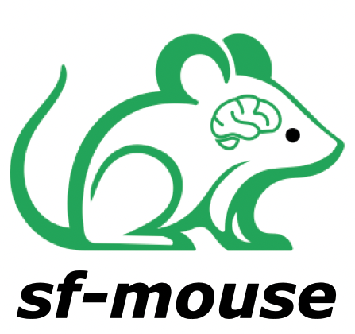

# sf-mouse

sf-mouse pipeline is developed by the Neurofunctional Imaging Group (GIN-IMN) and Sherbrooke Connectivity Imaging Lab (SCIL) in order to process diffusion MRI dataset from the raw data to the tractography.

Using on diffusion data sf-mouse is a nextflow pipeline based on [nf-neuro](https://github.com/scilus/nf-neuro).

It incorporates essential steps: denoising, corrections of some artefacts, registration to a template (Allen Mouse Brain Atlas), the DTI and QBall reconstructions, extraction of some metrics, until constructing a whole brain tractogram of the mouse brain and extracting some bundles. It is capable of adapting the resolution of the atlas according to the native data, for better anatomical alignment.


### Documentation:
--------------
sf-mouse documentation is available [here](https://scilus.github.io/sf-mouse/)
This documentation presents how to install and launch sf-mouse.

### In-vivo inputs and brain masks

The in-vivo workflow can be selected with `--invivo` or the `invivo` profile.
The profile also disables resampling, FODF metrics, and tracking by default.
Each subject requires its DWI image, b-values, and b-vectors as described in
the [input guide](https://scilus.github.io/sf-mouse/guides/inputs/). An
additional 3D anatomical image is optional:

```text
input/
  subject-01/
    subject-01_dwi.nii.gz
    subject-01_dwi.bval
    subject-01_dwi.bvec
    subject-01_anat.nii.gz  # optional
```

Anatomical images must end in `anat.nii.gz` and be in the same subject
directory as the DWI. The reference b=0 is extracted after Eddy correction
when Eddy is enabled, or from the uncorrected DWI otherwise. When anatomy is
present, ANTsPyNet extracts the anatomical brain mask and the anatomical image
is rigidly registered to the reference b=0;
the mask is transformed into DWI space using nearest-neighbor interpolation.
When no anatomical image is present, ANTsPyNet extracts the mask from the
reference b=0 instead. Subjects with and without anatomy can be mixed in one
run. A supplied `*mask.nii.gz` does not replace these in-vivo masks.

Set `--invivo_register_anat false` to skip rigid registration when an
anatomical image is already aligned to the DWI. If the grids differ, the mask
is resampled onto the b=0 grid without registration. Resampling alone does
not correct anatomical misalignment. This option has no effect on subjects
without anatomy. Inspect the mask and, where applicable, the registration as
part of quality control.

### :warning: WARNING :warning:
--------------
This pipeline is currently in development. We highly encourage everyone to give it a try and give us feedback and raise issues if any.

### In development features (non exhaustive list)

- BIDS compliant
- Meta metric QC across mouses
